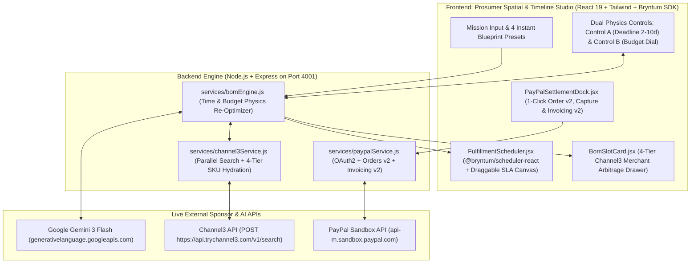

# ⚡ CartWeave (ChronosCart)
### Autonomous Multi-Merchant Procurement & Time-Physics Engine for the PayPal AI Hackathon

[](./LICENSE)
[](https://developer.paypal.com)
[](https://trychannel3.com)
[](https://bryntum.com)
[](https://ai.google.dev)

**CartWeave (ChronosCart)** is an autonomous multi-merchant procurement and **Time-and-Budget Physics Engine** designed for prosumers, studio builders, and operations teams. Instead of forcing buyers to hunt across 5 separate retailer websites, compare shipping lead times in a spreadsheet, and complete 5 separate checkouts, CartWeave decomposes a high-level project mission into an interdependent Bill of Materials (BOM), arbitrages live multi-retailer SKUs via **Channel3**, schedules critical-path delivery and on-site installation on a **Bryntum Scheduler**, and settles the entire multi-merchant bundle in a single **PayPal Sandbox Order v2 + Split Vendor Invoice v2**.

---

## 🟣 Why CartWeave is a "Purple Cow" (The 4 Core Mechanics)

1. **Goal & Visual Blueprint Decomposition (Google Gemini 3 Flash):**
   - Users enter any natural-language build mission (or select 1 of 4 instant Blueprint Presets: `🎙️ 4-Person Podcast Studio ($1,600 / 5 Days)`, `💻 Pop-Up 6-Seat Lagos Dev Lab ($2,400 / 4 Days)`, `📸 Product Photography Rig ($950 / 3 Days)`, `☕ Specialty Coffee Cart Launch ($1,800 / 6 Days)`).
   - **Gemini 3 Flash** decomposes the mission into 4–5 interdependent hardware slots with budget weights, on-site calibration tasks, and installation prerequisites.

2. **Live Multi-Retailer SKU Arbitrage (`POST https://api.trychannel3.com/v1/search`):**
   - For every BOM slot, the backend queries the live **Channel3 API** in parallel, extracting real merchant domains (`bestbuy.com`, `bhphotovideo.com`, `cdw.com`, `newegg.com`, `sweetwater.com`, `adorama.com`), live prices, `compare_at_price` MSRP spreads, and shipping tiers.
   - Hydrates every slot with **4 swappable Channel3 merchant tiers**: `Fastest Shipping Pick (1d)`, `Best Value Pick (2d)`, `Budget Pick (4–5d)`, and `Premium Flagship Pick`.

3. **"Time-and-Budget Physics" Interactive Bryntum Timeline (`@bryntum/scheduler` v7.3.0):**
   - **Control A — The Hard Launch Deadline Slider / Draggable SLA Line (2 to 10 Days):** Dragging the launch deadline earlier (e.g., from Day 5 down to Day 2 or 3) flags any slow-shipping merchant as an `SLA BREACH` and **autonomously swaps** that slot in real time to a faster-shipping verified Channel3 retailer so the critical path never misses launch day!
   - **Control B — The Live Target Budget Ceiling Dial:** Dragging the budget dial down or up dynamically re-optimizes the BOM across the Channel3 candidate pool (compressing to Budget/Value SKUs or upgrading to Pro SKUs) so the active cart never exceeds the user's budget ceiling.
   - Mounts both our interactive **Physics SLA Canvas** and the live **`@bryntum/scheduler-react` (`<BryntumScheduler />`)** SDK bound to `ResourceStore`, `EventStore`, and `DependencyStore`.

4. **Unified PayPal Multi-Merchant Cart & Split Invoice Settlement (`Orders v2` + `Invoicing v2`):**
   - Consolidates 4–5 distinct Channel3 retailers into **1 unified PayPal Sandbox Order (`POST /v2/checkout/orders`)** with itemized `purchase_units[0].items`, `NO_SHIPPING` clean checkout, and a cryptographic SHA-256 bundle hash in `custom_id`.
   - Supports live **Order Verification & Capture (`POST /v2/checkout/orders/:id/capture`)** and **Split Vendor Bill / Draft Invoice Generation (`POST /v2/invoicing/invoices`)**.

---

## 🏗️ System Architecture



---

## 🤖 Mandatory AI Tools & Models Disclosure

In compliance with hackathon rules, here is the exact disclosure of AI models and coding tools used:
1. **Runtime AI Engine (`services/bomEngine.js`):**
   - **Model:** Google **Gemini 3 Flash** (`gemini-3-flash-preview`) accessed via the OpenAI-compatible SDK (`https://generativelanguage.googleapis.com/v1beta/openai/`).
   - **Role:** Decomposes custom natural-language procurement missions into structured 4-to-5 slot Bills of Materials with budget weights, Channel3 search queries, on-site assembly tasks, and cross-slot installation dependencies.
2. **Development & Pair-Programming Assistant:**
   - **Tool:** **Google Antigravity** (AI coding assistant) used for full-stack scaffolding, Bryntum Scheduler store binding, and end-to-end verification scripting.

---

## 🧪 PayPal Sandbox Buyer Test Credentials (For Judges)

When testing the **1-Click PayPal Multi-Merchant Checkout** in the right-hand Settlement Dock, click **"Approve in PayPal"** and sign in with these Sandbox Buyer credentials (also available via 1-click copy buttons directly in the UI):

| Field | Value |
| :--- | :--- |
| **Sandbox Buyer Email** | `sb-piiac53570717@personal.example.com` |
| **Sandbox Buyer Password** | `yY9=iHM0` |

---

## 🚀 Quick Start (Local Development)

### 1. Clone & Install Dependencies
```bash
git clone https://github.com/KingPraise/cartweave-agent.git
cd cartweave-agent
npm install
npm --prefix client install --legacy-peer-deps
```

### 2. Configure Environment Variables
Copy `.env.example` to `.env` and populate your API keys:
```bash
cp .env.example .env
```
Required keys in `.env`:
- `PAYPAL_CLIENT_ID` & `PAYPAL_CLIENT_SECRET` (PayPal Developer Sandbox)
- `GEMINI_API_KEY` & `GEMINI_MODEL=gemini-3-flash-preview`
- `CHANNEL3_API_KEY` (Channel3 Product Intelligence API)

### 3. Build & Start Full-Stack Application
```bash
# Build the React + Bryntum frontend into client/dist
npm run build

# Start the Express server (serves both API and compiled frontend on http://localhost:4001)
npm start
```
Or run backend (`http://localhost:4001`) and Vite HMR frontend (`http://localhost:5174`) in development mode:
```bash
node server.js
npm run dev:client
```

### 4. Run End-to-End Live Verification Suite
```bash
npm test
```
This executes `test-verification.js`, verifying `/api/health`, `/api/presets`, `/api/blueprint/generate`, `/api/blueprint/optimize` (SLA deadline + budget compression auto-swaps), live `/api/channel3/search`, and live PayPal Sandbox Order v2 (`POST /v2/checkout/orders`), Capture check, and Invoicing v2 (`POST /v2/invoicing/invoices`).

---

## 📄 License
Distributed under the **MIT License**. See [`LICENSE`](./LICENSE) for full text.
